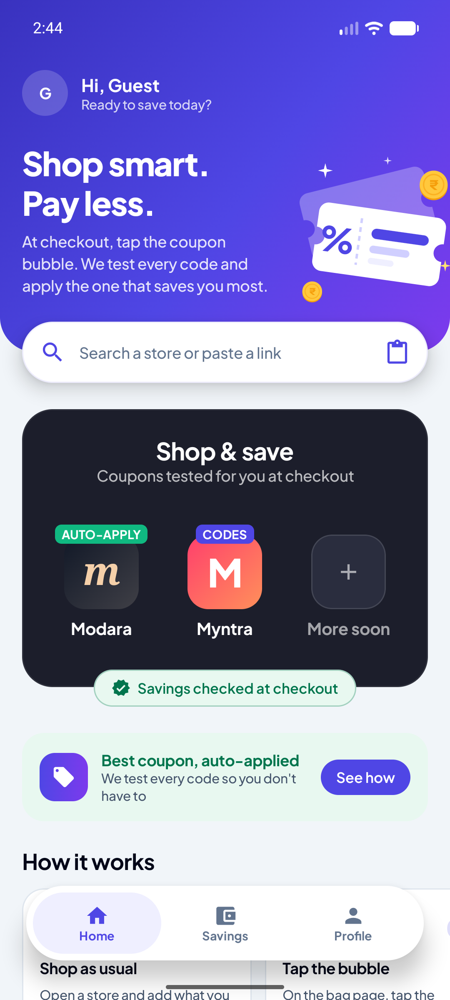
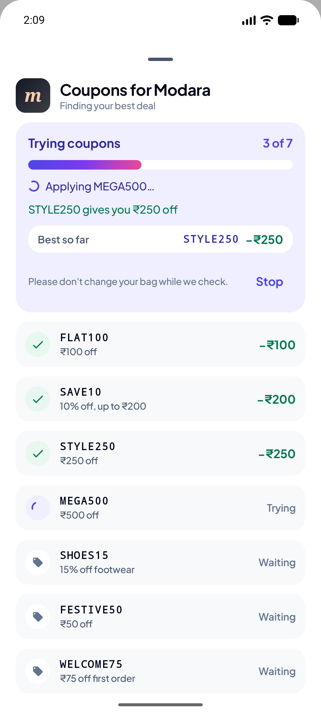
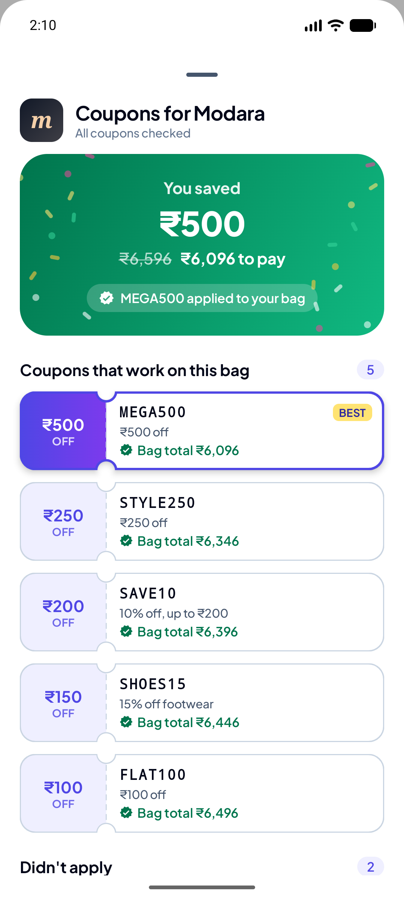
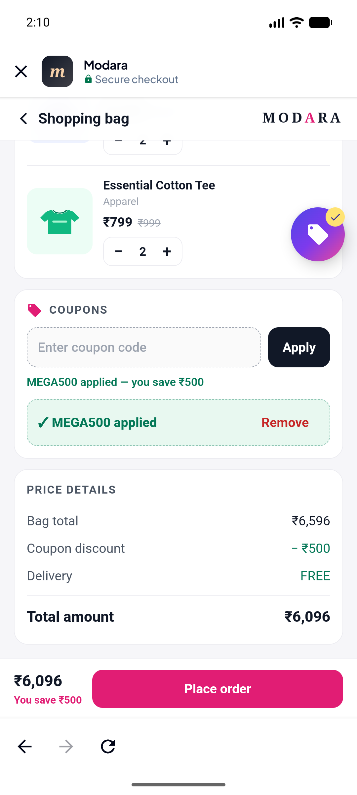
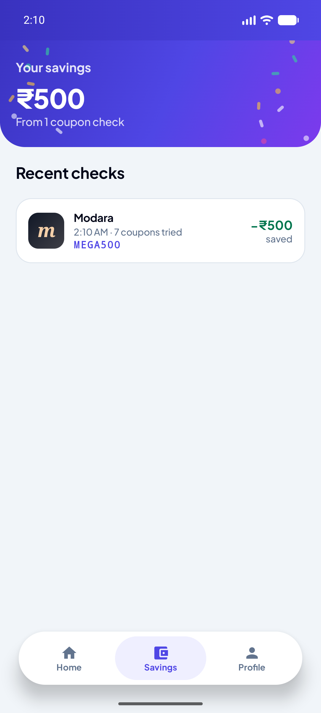
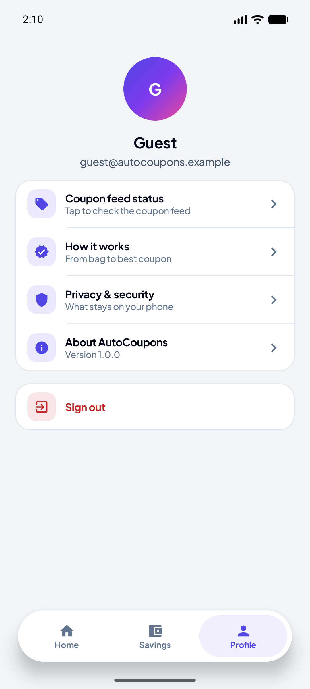
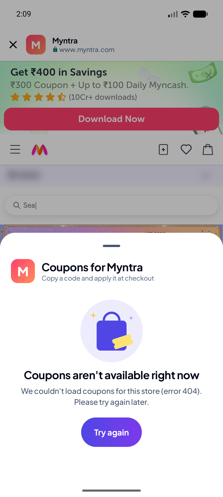

# AutoCoupons (Android)

AutoCoupons finds coupons for your shopping bag, **tests each one on the real checkout page inside the app**, keeps only the savings it actually observed, applies the best one, and checks the final total again.

> **Independent project.** This was built for the Buyhatke Android Developer assignment. It is **not** an official Buyhatke app, and no Buyhatke logo artwork is bundled. The colours are taken from Buyhatke's public brand assets (see `docs/RESEARCH.md`). The app says this in **Profile → About AutoCoupons**.

| Login | Home | Testing | Results | Bag after |
|---|---|---|---|---|
|  |  |  |  |  |

| Register | Store | Savings | Profile | Myntra (API down) |
|---|---|---|---|---|
|  |  |  |  |  |

Screenshots are from the Pixel 7 emulator (Android 16, 1080×2400). The run shown has two shoes and two tees in the bag (₹6,596), so MEGA500 wins.

## What works today

| Retailer | Coupons from | Testing |
|---|---|---|
| **Modara** (sample store bundled in the app; described as such in Profile → About) | Bundled coupon list | **Automated:** each coupon is applied, checked in the cart, and removed; the best is re-applied and verified |
| **Myntra** | Legacy Buyhatke API (`pos=2`) | **User-assisted:** codes are listed for you to copy. Myntra needs your login and has bot protection, so the app does not automate its page. |

**Live API status (checked 2026-10-24):** `coupons.buyhatke.com/PickCoupon/FreshCoupon/getCoupons.php` returns **HTTP 404** for `pos=1` and `pos=2`. The app reports this as "Coupons aren't available right now … (error 404)" and never substitutes sample data. Jabong now redirects to Myntra, so it is not offered.

## Try it

1. Install the APK (see below) and open **AutoCoupons**.
2. **Sign in:** tap **Continue as guest**. Alternatively, enter any valid email plus any non-empty password, or tap **Create account** (password of 8+ characters that is not rated weak; mix letters, numbers or symbols). Login is offline: nothing is sent or stored.
3. On Home, tap **Modara** in the *Shop & save* card.
4. Add the running shoes and the tee, open the bag, then tap the floating **coupon bubble** (or the **Coupons** button in the bottom bar when the bubble is hidden). Testing starts immediately; **Stop** cancels it and restores the bag.
5. Expected result: **STYLE250** wins, "You saved ₹250", ₹3,298 → **₹3,048**, applied to the bag and checked again. FLAT100 (₹100), SAVE10 (₹200), and SHOES15 (₹150) also work but save less; MEGA500 (minimum ₹5,000 not met), FESTIVE50 (expired), and WELCOME75 (not accepted by the store) are listed under *Didn't apply*.
6. Add the Canvas Weekender Bag (bag total ₹5,197) and tap **Check again**: **MEGA500** wins (₹4,697).

Modara's **Place order** button never places anything; it only shows a note that orders can't be placed in the sample store.

## Build

Requirements: JDK 17+ (Android Studio's bundled JBR is fine) and Android SDK 36. Create `local.properties` with `sdk.dir=…` if Android Studio has not already done so.

```bat
gradlew.bat assembleDebug
:: APK: app\build\outputs\apk\debug\app-debug.apk
adb install -r app\build\outputs\apk\debug\app-debug.apk

gradlew.bat testDebugUnitTest          :: 69 JVM tests
gradlew.bat lintDebug
gradlew.bat connectedDebugAndroidTest  :: 14 on-device tests, incl. accessibility and renderer crash (needs a device or emulator)
gradlew.bat assembleProfiling          :: R8 build signed with the debug key, for performance checks
```

## Libraries

Every dependency, as declared in `gradle/libs.versions.toml`:

| Library | Version | Purpose |
|---|---|---|
| Android Gradle Plugin (built-in Kotlin) | 9.2.1 | Build |
| Kotlin + Compose compiler plugin | 2.2.10 | Language, Compose compiler |
| Gradle wrapper | 9.4.1 | Build |
| androidx.core:core-ktx | 1.16.0 | Kotlin extensions (`toUri`) |
| androidx.activity:activity-compose | 1.10.1 | `ComponentActivity.setContent`, edge-to-edge, BackHandler |
| androidx.lifecycle:lifecycle-runtime-compose | 2.9.4 | `collectAsStateWithLifecycle` |
| androidx.lifecycle:lifecycle-viewmodel-compose | 2.9.4 | ViewModels, `SavedStateHandle` |
| androidx.navigation:navigation-compose | 2.9.5 | Navigation |
| androidx.webkit:webkit | 1.14.0 | `WebViewAssetLoader`, `addWebMessageListener` |
| androidx.compose:compose-bom | 2026.02.01 | Compose versions (ui, ui-graphics, ui-tooling(-preview), material3, ui-test-junit4, ui-test-manifest) |
| androidx.compose.material:material-icons-core | 1.7.8 | Core icons |
| *Font asset:* Plus Jakarta Sans (variable TTF, `res/font/plus_jakarta_sans.ttf`) | — | App typeface; SIL Open Font License 1.1 |
| org.jetbrains.kotlinx:kotlinx-coroutines-android | 1.10.2 | Coroutines and Flow |
| org.jetbrains.kotlinx:kotlinx-serialization-json | 1.9.0 | JSON parsing (`JsonElement` API; no compiler plugin) |
| com.squareup.okhttp3:okhttp | 4.12.0 | HTTP client for the coupon API |
| *Tests:* junit:junit | 4.13.2 | Unit tests |
| *Tests:* kotlinx-coroutines-test | 1.10.2 | `runTest`, virtual time |
| *Tests:* com.squareup.okhttp3:mockwebserver | 4.12.0 | API provider tests |
| *Tests:* androidx.compose.ui:ui-test-junit4-accessibility | BOM (1.10.4) | Accessibility Test Framework checks in Compose tests |
| *Tests:* androidx.test.ext:junit | 1.3.0 | Instrumented tests |
| *Tests:* androidx.test:runner | 1.7.0 | Instrumented tests |
| *Tests:* androidx.test.espresso:espresso-core | 3.7.0 | Required by the Compose test rule |

## How it works

```
Fetch coupons (one source) → read bag → remove any code you had (baseline)
  → for each coupon: apply → read totals → keep only if accepted AND total = subtotal − saving → remove → bag back to baseline?
  → rank verified savings (largest saving, then lowest total, then feed order, then code)
  → apply the winner again → verify the saving matches → done
Cancel or failure at any point: your bag is restored (your own code, or none).
```

Purchase controls (Place Order, Pay, Buy) are never touched.

Details: [`docs/ARCHITECTURE.md`](docs/ARCHITECTURE.md).

## Documentation

| Document | Contents |
|---|---|
| [RESEARCH](docs/RESEARCH.md) | API, retailer, and brand findings with dates and commands; toolchain |
| [FEASIBILITY](docs/FEASIBILITY.md) | What can and cannot be automated, and why |
| [REQUIREMENTS](docs/REQUIREMENTS.md) | Requirements with status and evidence |
| [ARCHITECTURE](docs/ARCHITECTURE.md) | Modules, interfaces, pipeline, WebView bridge |
| [UI_DESIGN](docs/UI_DESIGN.md) | Tokens with sources, screens, accessibility |
| [TESTING](docs/TESTING.md) | Commands, results, test inventory, Modara expectations |
| [PERFORMANCE](docs/PERFORMANCE.md) | Start-up, memory, frames, and what was not measured |
| [SECURITY](docs/SECURITY.md) | Data handling, TLS, WebView hardening, checkout safety |
| [CHECKLIST](docs/CHECKLIST.md) | Implementation checklist by phase |

## Known limitations

- The legacy live API currently returns 404, so no live coupons can be shown. The parser is tolerant, but it has never seen a real production payload; the historical schema could not be recovered.
- Automated testing runs only on the bundled Modara sample store. Myntra is user-assisted.
- Login and registration are offline. Sessions and savings history live in memory and end when the process dies.
- The redesigned UI was checked on the Pixel 7 emulator (Android 16) in light and dark mode and on a small screen at 130 % text, and all 14 instrumented tests pass there. An earlier build was also run on one physical device (Android 16); the redesign has not been re-run there.
- No spoken TalkBack walkthrough; automated accessibility checks pass.
- No Macrobenchmark or Baseline Profile; per-app battery use was not measured.
